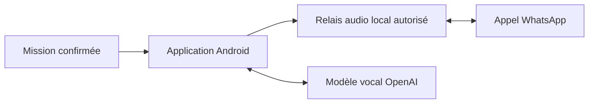

# WhatsApp AI

**Un assistant IA Android pour les appels WhatsApp consentis.** Préparez une mission, faites participer l’assistant et gardez la possibilité de reprendre la main.

[English](README.md) · Créé par **Charadi Badr** · Code applicatif sous licence MIT

> **Expérimental — essais sur téléphone uniquement sur le Pixel 8 Pro de l’auteur, avec l’API OpenAI. Aucun autre téléphone ni fournisseur n’est validé.**

[**Télécharger l’APK 0.22-beta**](https://github.com/iasibadr/whatsapp-ai/releases/download/v0.22-beta/whatsapp-ai-0.22.apk) · [**Installer**](docs/INSTALLATION.md) · [**Participer aux essais Android**](https://github.com/iasibadr/whatsapp-ai/issues/3)

## Fonctionnement

Configurez une mission et utilisez un relais audio local explicitement autorisé. Deux modèles OpenAI sont proposés : **Économique (Mini)** et **Complet**. Consultez [leurs tarifs](docs/VOICE_PROVIDERS.md).

Chaque utilisateur configure ses propres identifiants API. Le relais fonctionne sur le téléphone ; le traitement vocal utilise OpenAI via Internet. L’IA ne fonctionne donc pas hors ligne.

L’application cible WhatsApp standard, pas WhatsApp Business. Projet communautaire indépendant, non officiel WhatsApp, Meta ou OpenAI.

## État réel des essais

| Élément | État |
|---|---|
| Téléphone utilisé | Pixel 8 Pro de l’auteur uniquement |
| Fournisseur utilisé | API OpenAI ; chaque modèle et scénario n’est pas certifié séparément |
| Relais local | Démarrage observé sur Pixel 8 Pro / Android 17 |
| Audio complet de l’appel | Un voyant prêt ne prouve pas l’audio distant ; retours d’essais consentis encore nécessaires |
| Autres téléphones et reprise après redémarrage complet | Non établis |

Le manifeste de l’APK indique 0.22-beta ; une constante interne affiche encore 0.19-beta. Contrôles du code : 164 assertions Java ; lint signale 21 erreurs et 86 avertissements encore à traiter. Les tests du code ne constituent ni une validation audio sur téléphone ni une certification de sécurité. Voir [les preuves et limites](docs/VALIDATION.md), [l’audit](AUDIT.md) et [la compatibilité](docs/COMPATIBILITY.md).

## Avant l’installation

Lisez [le guide d’installation](docs/INSTALLATION.md) et [les permissions et la confidentialité](docs/PRIVACY.md). L’association locale par débogage sans fil donne des capacités de niveau shell ; la permission microphone seule ne suffit pas. Ne contournez pas les contrôles et n’importez pas les identifiants d’autrui. Faites les essais avec un participant informé et consentant, en conservant le contrôle manuel.

L’APK fourni est conservé sans modification. Vérifiez [son empreinte SHA-256](downloads/SHA256SUMS) et [les notes de version](docs/RELEASE_NOTES.md).

## Participer

- **Tester un autre téléphone :** indiquez modèle, versions Android/application et résultats dans [l’appel aux testeurs](https://github.com/iasibadr/whatsapp-ai/issues/3). Les échecs sont aussi utiles que les réussites.
- **Améliorer le guide :** consultez [les premières contributions accessibles](https://github.com/iasibadr/whatsapp-ai/issues?q=is%3Aissue%20is%3Aopen%20label%3A%22good%20first%20issue%22).
- **Demander un autre fournisseur vocal :** utilisez [le formulaire](https://github.com/iasibadr/whatsapp-ai/issues/new?template=voice_provider_request.md). Son ajout dépendra de la faisabilité, des contributeurs et des tests ; aucun délai n’est promis.
- **Signaler un problème :** ouvrez une [issue](https://github.com/iasibadr/whatsapp-ai/issues/new/choose). Voir [l’aide](SUPPORT.md) et [le signalement de vulnérabilités](SECURITY.md).

Ne publiez aucune clé API, contact, numéro, code d’association, conversation privée, enregistrement ou journal non vérifié.

## Ressources techniques

[Compilation](docs/BUILD.md) · [Contribution](CONTRIBUTING.md) · [Feuille de route](docs/ROADMAP.md) · [Historique](CHANGELOG.md) · [Licences tierces](THIRD_PARTY_NOTICES.md)

Autre projet : [Appel AI](https://github.com/iasibadr/appel-ai).
