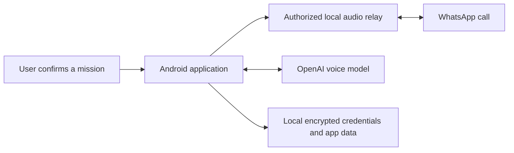

# WhatsApp AI

> **Device testing: Pixel 8 Pro only.** All physical-phone testing so far has been on the author's Pixel 8 Pro. Other Android devices are unvalidated. This does not establish every call scenario or reboot recovery. [Help test another Android phone](https://github.com/iasibadr/whatsapp-ai/issues/3).
>
> **Essais sur téléphone : uniquement le Pixel 8 Pro de l’auteur.** Aucun autre modèle Android n’est validé à ce jour.

 · [Releases](https://github.com/iasibadr/whatsapp-ai/releases) · [Compatibility](docs/COMPATIBILITY.md) · [Roadmap](docs/ROADMAP.md) · [Support](SUPPORT.md)

Build status covers the configured checks, not real-device audio or a security audit. Lint remains a separately reported diagnostic with known errors.

**An Android assistant for consented WhatsApp calls.**
Created by **Charadi Badr** · Android native Java · MIT application code.

WhatsApp AI prepares a mission, launches a user-confirmed WhatsApp call and connects an AI voice worker through an explicitly authorized local audio relay. It targets standard WhatsApp, not WhatsApp Business.

This is a community research release, not an official WhatsApp, Meta or OpenAI product. No computer is required for routine use after supported local setup, but network access to the model provider is required. This is not an offline AI model.

## Voice model choice

**Tested provider: OpenAI API. Tested phone: the author's Pixel 8 Pro only.** The source offers OpenAI Complet and Economique models. Other providers are not integrated or tested. See the [provider options, dated cost comparison and contribution plan](docs/VOICE_PROVIDERS.md).

**Fournisseur utilise pour les essais : API OpenAI.** Autres fournisseurs et autres telephones non valides.

## Status

The supplied APK is version **0.22-beta**. Source and APK provenance, hashes and limitations are in [VALIDATION.md](docs/VALIDATION.md). Local relay startup was observed on Pixel 8 Pro / Android 17. A ready indicator does not prove that a remote caller hears the AI. Other phones and Android versions need their own consented call test. Automatic recovery after a full reboot is not established.

## Download

[Download the supplied APK](https://github.com/iasibadr/whatsapp-ai/releases/download/v0.22-beta/whatsapp-ai-0.22.apk) · [SHA-256](downloads/SHA256SUMS) · [Release notes](docs/RELEASE_NOTES.md)

The APK is the original supplied build. It is not rebuilt or re-signed during publication. Its manifest reports 0.22-beta; an older internal display constant still says 0.19-beta.

**Known technical debt:** the new Gradle lint run reports 21 errors and 86 warnings. Compilation and 164 pure-Java policy checks pass, but the lint findings are not fixed or suppressed. See [the audit](AUDIT.md). This is not a production security clearance.

## Start here

1. Read [installation and usage](docs/INSTALLATION.md), including the local wireless-debugging prerequisite.
2. Review [privacy and permissions](docs/PRIVACY.md). Each user supplies their own API credentials and pays their own provider usage.
3. Use the APK supplied with this project when available, or [build from source](docs/BUILD.md). Never import another person's pairing identity or key.
4. Test only with an informed participant and retain manual control of the call.

## What is included

- Native Android UI, mission configuration and call state handling.
- Local activation and a privileged relay, with explicit authorization checks.
- OpenAI voice integration, local encrypted credential storage and bounded message handling.
- Source, policy tests, license notices and publication checks.

## Architecture

The relay depends on device-specific Android behavior and shell privileges granted through user-controlled local pairing. An ordinary microphone permission alone does not provide call capture/injection. Do not disable safety checks to force unsupported devices to work.

## Français

**WhatsApp AI** est une application Android créée par **Charadi Badr** pour confier une mission à une IA pendant un appel WhatsApp, avec accord des participants. Chaque utilisateur configure sa propre clé et son propre téléphone. Le fonctionnement courant est local au téléphone, avec connexion au fournisseur IA. Le relais a été démarré sur Pixel 8 Pro sous Android 17 ; la compatibilité universelle et la reprise après redémarrage ne sont pas garanties.

Voir le [guide français](docs/INSTALLATION.md), les [preuves et limites](docs/VALIDATION.md) et les [règles de confidentialité](docs/PRIVACY.md).

## Contribute

See [CONTRIBUTING.md](CONTRIBUTING.md), [SECURITY.md](SECURITY.md) and [third-party notices](THIRD_PARTY_NOTICES.md). Useful contributions include reproducible compatibility reports, consented audio tests, safer setup and documented failure cases. Do not post phone numbers, API keys, pairing codes, conversations or raw device dumps.

## Android community testing / Retours Android

**I welcome test reports across Android phone brands and models.** Compatibility is not assumed: share installation, relay startup, consented two-way call audio, manual takeover and reboot results through the [Android compatibility issue template](.github/ISSUE_TEMPLATE/android_compatibility.md).

**J’attends vos retours d’essais sur les différents téléphones Android** : marque, modèle, version Android, installation et résultat d’un appel consenti. Les réussites et les échecs nous aideront à préciser la compatibilité. Ne partagez ni contacts, numéros, conversations, clés API ni codes d’association.

## Project keywords

`android`, `ai-calling`, `ai-voice-agent`, `voice-agents`, `voice-assistant`, `openai-realtime-api`, `adb`, `wireless-debugging`, `apk`, `java`, `realtime-audio`, `open-source`, `experimental`, `whatsapp`, `whatsapp-ai`.
